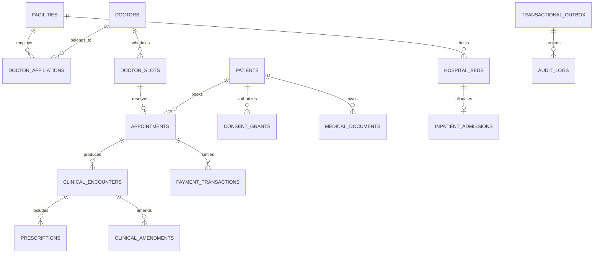

# SVASTHNEXIS — Database Architecture & Persistence Specification
**Version:** 2.0.0  
**Storage Engine:** PostgreSQL 16+ (Transactional Authority)  
**Package:** `@svasthnexis/database`

---

## 1. Schema Design & Table Relationships

The relational schema is defined through versioned SQL migrations in `packages/database/migrations/`:
- `001_initial_schema.sql`: Core tables for facilities, doctors, patients, appointments, slots, medical documents, consents, encounters, prescriptions, payments, audit events, and the transactional outbox table.
- `002_row_level_security.sql`: Multi-tenant isolation enforcing `tenant_id` validation via PostgreSQL Row-Level Security (RLS).
- `003_immutability_triggers.sql`: Before-update and before-delete database triggers preventing modification of signed clinical encounters and audit log rows.

### Core Entity Relationship Diagram



---

## 2. Concurrency Control & Double-Booking Prevention

To eliminate race conditions during concurrent appointment bookings:
1. **Row-Level Locking:** When an appointment slot is held, PostgreSQL acquires an exclusive lock via:
   ```sql
   SELECT * FROM doctor_schedule_slots WHERE id = $1 FOR UPDATE;
   ```
2. **State Machine Verification:** If slot status is not `AVAILABLE`, the transaction rolls back immediately and returns HTTP 409 Conflict.
3. **Slot TTL Lock:** An expiration timestamp (`held_until`) is stamped. If checkout is not completed within 10 minutes, the lock expires automatically.
4. **Idempotency Key Enforcement:** Payment transactions record unique `idempotency_key` values in PostgreSQL; duplicate webhook delivery attempts return the existing processed record without re-crediting.

---

## 3. Transactional Outbox Pattern

All critical events (e.g. `AppointmentConfirmed`, `PatientAdmitted`, `EmergencyResuscitationScheduled`) are written to the `transactional_outbox` table in the exact same transaction as the entity state update:

```sql
INSERT INTO transactional_outbox (event_id, event_type, aggregate_type, aggregate_id, payload, created_at)
VALUES ($1, $2, $3, $4, $5, NOW());
```

A background polling worker reads unpublished outbox rows, broadcasts them to event consumers, and marks `published_at = NOW()`.

