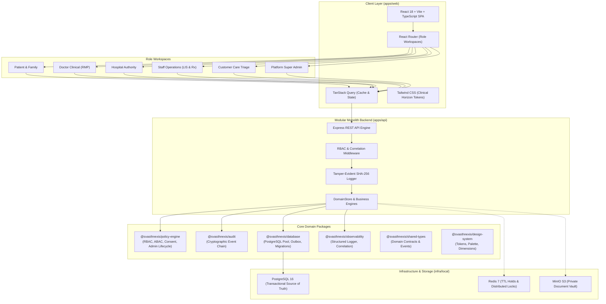

# SVASTHNEXIS — Final System Architecture
**Version:** 2.0.0  
**Blueprint:** Enterprise Unified Healthcare Management Ecosystem (Modular Monolith)  
**Author:** Principal Software Architect

---

## 1. Architectural Topology

---

## 2. Key Architecture Decisions

1. **Modular Monolith over Microservices (ADR-001):** Single deployable artifact containing cleanly bounded internal packages (`packages/*`). Eliminates distributed transaction failures, network serialization overhead, and RPC latency while preserving strict domain boundaries.
2. **Multi-Tenant Isolation (ADR-002):** Every hospital facility represents an isolated tenant partition with row-level security policies (`tenant_id = current_setting(...)`).
3. **Signed Clinical Immutability (ADR-004):** Once a registered medical practitioner signs an encounter or prescription, it is immutable. PostgreSQL triggers reject `UPDATE` or `DELETE`; modifications must be appended as linked `ClinicalAmendment` addenda.
4. **Scoped Consent Policy (ADR-005):** Patients retain explicit sovereignty over health records. Consents define granular purpose, permitted document categories, and validity windows. Immediate revocation terminates access tokens instantly.
5. **Transactional Outbox Eventing (ADR-007):** Domain events (e.g. `AppointmentConfirmed`, `PaymentCaptured`) are committed into PostgreSQL within the same ACID transaction as the business entity, eliminating split-brain state between database and message brokers.
6. **Bounded AI Services with Mandatory Human Review (ADR-009):** Five isolated AI services operate under strict non-diagnostic boundaries: AI outputs require clinical human review and digital acceptance prior to record commitment.

