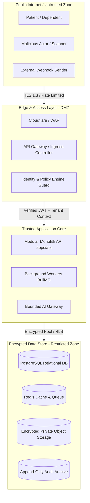

# Threat & Safety Model
## Unified Healthcare Management Ecosystem (SvasthNexis)
**Document Status:** Approved Baseline (Stage 0 Foundation)  
**Methodology:** STRIDE Threat Modeling + Healthcare Clinical Safety Risk Assessment (DCB0129)

---

### 1. Trust Boundaries & Actors

### 2. Primary Assets Under Protection
1. **Protected Health Information (PHI) & SPI:** Patient consultations, diagnostic lab values, prescriptions, medical histories.
2. **Access Control & Identity:** Passwords, TOTP secrets, session tokens, tenant membership claims.
3. **Financial Records:** Invoices, payments, settlement ledger, refund authorizations.
4. **Clinical Integrity & Trust:** Doctor professional credentials, verified facility licences, signed clinical notes.
5. **System Audit Trail:** Historical access logs, amendment records, break-glass logs.

---

### 3. STRIDE Threat Analysis & Mitigations

| Threat Category | Potential Attack / Vulnerability Scenario | Likelihood | Impact | Concrete Mitigation in Architecture |
|---|---|---|---|---|
| **Spoofing** | Attacker impersonates a doctor to view patient records or forge prescriptions. | Medium | Critical | Mandatory OIDC/MFA for all clinician logins; digital signature on prescriptions; token expiration (15m) with refresh rotation. |
| **Tampering** | Malicious user or rogue staff modifies a signed clinical note or alters payment transaction amount. | Low | Critical | Database constraints prohibit SQL UPDATE on signed records; amendments are append-only child entities; payment amounts verified against signed webhooks; immutable ledger. |
| **Repudiation** | Doctor claims they did not prescribe a medication, or patient denies consenting to record sharing. | Low | High | Cryptographically signed digital audit logs; consent capture logs exact notice version, IP, user ID, timestamp, and method. |
| **Information Disclosure** | IDOR vulnerability allows Hospital A user to query `/api/v1/patients/123/documents` belonging to Hospital B. | High | Critical | Server-side authorization derives tenant ID exclusively from verified JWT token; PostgreSQL Row-Level Security (RLS) acts as defense in depth. Object storage strictly blocks public access; signed URLs have 15-min TTL. |
| **Denial of Service** | Botnet floods booking API to hold all available doctor appointment slots. | High | High | Distributed rate-limiting in Redis; CAPTCHA on unauthenticated slot browsing; maximum 3 active slot holds per patient account; automated 10-minute hold expiration worker. |
| **Elevation of Privilege** | Customer Care agent attempts to access full clinical chart or promote an account to platform admin. | Medium | High | Strict ABAC policy engine checking roles against explicit deny lists; maximum 5 platform admins enforced; two-person approval for privileged operations. |

---

### 4. Abuse & Hazardous Edge Scenarios
1. **Concurrent Double-Booking Race Condition:** Two patients attempt to book the exact same doctor slot simultaneously.
   - *Mitigation:* Atomic PostgreSQL row lock (`SELECT ... FOR UPDATE`) or exclusion constraint on active `(slot_id, status='HELD')`.
2. **Payment Webhook Replay Attack:** Attacker replays a valid `payment.succeeded` webhook to mark multiple appointments confirmed or trigger balance exploits.
   - *Mitigation:* Webhook idempotency table records `event_id`. Duplicate webhook requests return `200 OK` without re-processing ledger updates.
3. **Emergency Red-Flag Masking via Chatbot:** Patient experiencing myocardial infarction asks chatbot for advice.
   - *Mitigation:* Hard-coded emergency heuristic detector triggers immediate emergency guidance modal, stopping standard appointment triage and displaying emergency hotlines.

