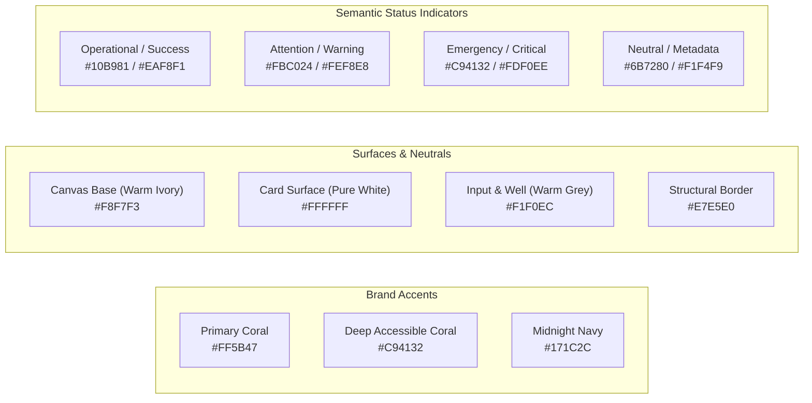

# SVASTHNEXIS — Unified Stitch Design System Specification
**Version:** 2.0.0  
**Design Authority:** Google Stitch MCP Designs (`Clinical Horizon`) & SvasthNexis Brand Tokens  
**Scope:** Design tokens, component rules, typography, color semantics, and responsive layout specifications.

---

## 1. Design Vision & Philosophy

SvasthNexis marries the aesthetic polish of high-end European SaaS and FinTech rigor with the strict safety and clarity demands of enterprise healthcare operations.

Key tenets:
1. **Calibrated Urgency:** The primary brand accent is Warm Vermilion/Coral (`#FF5B47` / `#C94132`), commanding immediate attention for primary actions and critical alerts without inducing visual panic or clinical alarm fatigue.
2. **Warm Executive Neutrality:** A foundation of Warm Ivory (`#F8F7F3`), Warm Light Grey (`#F1F0EC`), and Pure White (`#FFFFFF`) card surfaces eliminates screen glare during long hospital shifts while presenting a welcoming, modern feel.
3. **Architectural Density:** Information-dense layouts structured around a 12-column fluid grid, 8pt spatial rhythm, and strict typographic hierarchy maximize data throughput for clinicians and administrators across complex multi-facility hospitals.
4. **Semantic State Distinction:** Clinical status tags (Normal/Open, Warning/Pending, Emergency/Critical) use dedicated semantic colors completely isolated from the brand accent to prevent cognitive confusion.

---

## 2. Core Palette & Color Tokens

### 2.1. Color Hex Codes & Variables

| Token Name | Hex Code | Tailwind Token | Semantic Usage |
|---|---|---|---|
| **Canvas Base** | `#F8F7F3` | `bg-warm-ivory` | Main viewport background, restful low-glare surface. |
| **Card Surface** | `#FFFFFF` | `bg-white` | Analytical cards, data modules, modal sheets, popovers. |
| **Well Surface** | `#F1F0EC` | `bg-warm-light-grey`| Input fields, search bars, table headers, inactive tracks. |
| **Structural Border** | `#E7E5E0` | `border-soft-grey` | 1px clean separation borders across all cards and dividers. |
| **Primary Coral** | `#FF5B47` | `bg-coral` / `text-coral` | Primary interactive CTAs, active tab underlines, key metrics. |
| **Deep Coral** | `#C94132` | `bg-coral-deep` | High-contrast accessible text on white, destructive actions. |
| **Midnight Navy** | `#171C2C` | `text-navy` | Primary headings, quantitative numbers, table values. |
| **Slate Grey** | `#6B7280` | `text-slate` | Metadata, microcopy, column labels, secondary icons. |
| **Emerald Green** | `#10B981` | `text-emerald-600` | Bed available, verified credentials, completed tests, payment OK. |
| **Golden Amber** | `#FBC024` | `text-amber-500` | Pending approval, triage hold, low stock, review needed. |
| **Hero Gradient** | `#F9EBE8` → `#F4EEF0` → `#EEF0F4` | `bg-hero-gradient` | Executive operational banner, patient welcome strip. |

---

## 3. Typography Hierarchy

The typography employs two complementary geometric typefaces:
- **Plus Jakarta Sans:** Expressive, clean geometric sans-serif for headings, metrics, and high-level branding.
- **Inter:** Ultra-legible workhorse for dense tabular data, operational status tags, forms, and clinical notes.

| Style Role | Font Family | Size | Weight | Line Height | Tracking | Usage |
|---|---|---|---|---|---|---|
| **Metric Display** | Plus Jakarta Sans | 32px (`2rem`) | 700 (Bold) | 38px | -0.03em | Primary KPI card numbers |
| **Headline XL** | Plus Jakarta Sans | 36px (`2.25rem`) | 700 (Bold) | 44px | -0.025em | Main dashboard titles |
| **Headline LG** | Plus Jakarta Sans | 28px (`1.75rem`) | 700 (Bold) | 36px | -0.02em | Section titles, drawer headers |
| **Headline MD** | Plus Jakarta Sans | 20px (`1.25rem`) | 600 (Semibold) | 28px | -0.015em | Card headers, table titles |
| **Headline SM** | Plus Jakarta Sans | 16px (`1rem`) | 600 (Semibold) | 24px | -0.01em | Subsections, item titles |
| **Body LG** | Inter | 16px (`1rem`) | 400 (Regular) | 24px | Normal | Editorial text, patient summaries |
| **Body MD** | Inter | 14px (`0.875rem`)| 400 (Regular) | 20px | Normal | General body copy, form labels |
| **Body MD Medium** | Inter | 14px (`0.875rem`)| 500 (Medium) | 20px | Normal | Table text, active list items |
| **Body SM** | Inter | 12px (`0.75rem`) | 400 (Regular) | 16px | Normal | Secondary metadata, timestamps |
| **Label MD** | Inter | 12px (`0.75rem`) | 600 (Semibold) | 16px | +0.04em | Badges, chips, uppercase tabs |
| **Label SM** | Inter | 11px (`0.6875rem`)| 600 (Semibold) | 14px | +0.05em | Table column headers (uppercase) |

> [!NOTE]
> All quantitative metrics and financial figures must enforce `font-variant-numeric: tabular-nums` to ensure perfect vertical alignment across dynamic updates.

---

## 4. Spacing, Shapes & Elevation

### 4.1. 8-Point Spatial System
- `space-xs`: 4px (`0.25rem`) — Micro spacing, icon gaps
- `space-sm`: 8px (`0.5rem`) — Status pill padding, tight list item gaps
- `space-md`: 12px (`0.75rem`) — Form field inner padding, badge spacing
- `space-lg`: 20px (`1.25rem`) — Standard card internal padding
- `space-xl`: 28px (`1.75rem`) — Major section spacing, drawer padding
- `space-2xl`: 32px (`2rem`) — Viewport outer margins (Desktop)

### 4.2. Rounded Radii
- **Standard Cards & Modals:** 12px (`rounded-lg` / `rounded-xl`)
- **Interactive Controls (Buttons, Inputs, Selects):** 10px (`rounded-md`)
- **Status Badges, Priority Chips, Avatars:** Fully rounded pill (`rounded-full` / 9999px)
- **Table Cells & Hover Wells:** 6px (`rounded-sm`)

### 4.3. Elevation & Shadows
- **Base Canvas (Layer 0):** No shadow, pure `#F8F7F3`.
- **Card Deck (Layer 1):** `box-shadow: 0 1px 3px rgba(23, 28, 44, 0.04), 0 4px 12px rgba(23, 28, 44, 0.02);` framed by 1px solid `#E7E5E0`.
- **Interactive Floating / Popovers (Layer 2):** `box-shadow: 0 4px 6px -1px rgba(23, 28, 44, 0.06), 0 10px 24px -3px rgba(23, 28, 44, 0.08);`.
- **Modal Dialogs (Layer 3):** `box-shadow: 0 20px 32px -4px rgba(23, 28, 44, 0.16);` with backdrop blur (`backdrop-blur-sm bg-navy/45`).

---

## 5. Reusable Component Patterns

### 5.1. Persistent Role Navigation Rail
- **Desktop (>=1440px):** 264px persistent left sidebar with brand logo, workspace switcher, role-specific navigation links with icon + label + unread badge, and active user profile footer.
- **Tablet (768px - 1439px):** Collapsible to 72px icon-only docking rail with tooltips on hover.
- **Mobile (<768px):** Off-canvas drawer triggered by hamburger header, plus bottom mobile navigation bar for top 4 actions.

### 5.2. Executive Hero Banner
- Rendered with soft three-stop gradient `linear-gradient(110deg, #F9EBE8 0%, #F4EEF0 52%, #EEF0F4 100%)`.
- Contains:
  - Role greeting / Facility status badge
  - Real-time operational breadcrumb or active encounter timer
  - Top action controls (e.g. "Admit Patient", "Emergency SOS", "New Consultation")

### 5.3. KPI Statistics Card
- Pure White background, 1px border `#E7E5E0`, 12px rounded corner.
- Top row: Slate Grey uppercase label (`label-sm`), trailing icon in subtle rounded container.
- Main value: `metric-display` in Midnight Navy.
- Bottom trend: `+4.2% from yesterday` in Emerald Green (positive) or Coral Deep (alert) with micro sparkline or progress bar.

### 5.4. Clinical & Administrative Data Tables
- Header: 44px height, `#F8F7F3` background, 1px border-bottom, uppercase `label-sm` in Slate Grey.
- Rows: 52px height, Pure White background, 1px border-bottom `#F1F0EC`, hover highlight `#FAF9F6`.
- High-priority rows (e.g. Critical Lab, ER Triage ESI-1) feature a 3px vertical border highlight in Coral (`#FF5B47`) on the left edge.
- Actions column: Dropdown menu or quick icon action buttons (View, Edit, Verify).

### 5.5. Status Badges & Priority Chips
- Height: 24px, padding: 2px 10px, border-radius: 9999px.
- **Normal / Success:** Green text `#10B981`, pale mint background `#EAF8F1`, 1px border `rgba(16, 185, 129, 0.2)`. Preceded by 6px emerald pulse dot.
- **Warning / Review:** Amber text `#B88700`, soft yellow background `#FEF8E8`, 1px border `rgba(251, 192, 36, 0.3)`.
- **Critical / Emergency:** Coral text `#C94132`, soft coral background `#FDF0EE`, 1px border `rgba(201, 65, 50, 0.2)`.
- **Neutral / Draft:** Slate text `#4B5563`, warm grey background `#F1F4F9`, 1px border `#E2E7F0`.

