# SVASTHNEXIS — Current State Audit & Architectural Baseline Report
**Date:** 4 November 2026  
**Auditor:** Principal Software Architect, Senior Full-Stack Engineer, Healthcare Systems Engineer  
**Workspace:** `/Users/satyabratadas/Documents/SVASTHNEXIS`  
**Git Branch:** `main` | Commit: `5404c41`  

---

## 1. Executive Summary

This comprehensive audit evaluates the active workspace of **SvasthNexis**, an enterprise-grade Unified Healthcare Management Ecosystem prototype. The repository was thoroughly inspected across all packages, applications, test suites, architecture documents, and Stitch MCP design assets.

### Key Findings:
1. **Core Business Logic is Rich and Validated:** The backend domain store (`apps/api/src/store.ts`, 2338 lines) and API layer (`apps/api/src/app.ts`, 806 lines) already contain extensive, production-grade business rules, state machines, and acceptance test logic covering scheduling, atomic slot holds, consent management, clinical immutability, bed management, LIS pathology validation, pharmacy formulary, emergency triage, and audit hashing. 50 tests (20 unit, 30 integration) are actively passing.
2. **Frontend Architecture Requires Modernization:** The user interface is currently rendered through a single monolithic 4,159-line file (`apps/api/src/public/index.html`) using vanilla JavaScript, inline Tailwind classes via CDN, and DOM manipulation. While it demonstrates interactive workflows, it lacks modularity, component reusability, compile-time type safety, and state management required for an enterprise platform. Per Section 5 of the master prompt, a modern React/TypeScript/Vite/Tailwind frontend application (`apps/web/`) must be constructed.
3. **Stitch Designs are Fully Available:** All six Stitch role-based interface designs have been retrieved from Google Stitch MCP, inspected, and saved locally (`docs/design/stitch-raw/`). They provide concrete layouts, typography, component hierarchies, and visual styles for the six core workspaces.
4. **Persistence & Infrastructure Gaps:** The running server operates with an in-memory `DomainStore`. Local Docker Compose definitions (`infra/local/docker-compose.yml`) and PostgreSQL DDL migrations (`packages/database/migrations/`) exist but are not yet connected to runtime API handlers. Redis and MinIO are similarly specified but not active.
5. **Authentication is Simulated:** Endpoints currently authenticate via hard-coded identity simulations (`UserSession`) and demo query/body parameters. A production-grade JWT/OIDC authentication architecture with refresh tokens, RBAC/ABAC enforcement, and secure session management must be implemented.
6. **Missing Test Suites:** `npm run test:concurrency` and `npm run test:security` fail because the corresponding directories (`tests/concurrency`, `tests/security`) contain no test files.

---

## 2. Workspace Inventory & Package Structure

| Path / Workspace | Type | Version | Status & Responsibilities |
|---|---|---|---|
| `/` (Root) | Monorepo Root | `1.0.0` | Orchestrates npm workspaces, root scripts, Vitest test suites. |
| `packages/shared-types` | Package | `1.0.0` | Shared TypeScript interfaces for domains, entities, sessions, and events. |
| `packages/policy-engine` | Package | `1.0.0` | RBAC/ABAC policy engine, scoped consent evaluation, admin governance rules. |
| `packages/database` | Package | `1.0.0` | PostgreSQL connection pool, migration runner, transactional outbox. |
| `packages/audit` | Package | `1.0.0` | Tamper-evident SHA-256 cryptographic audit chain logger. |
| `packages/observability` | Package | `1.0.0` | Structured JSON logger, request correlation ID generator (`x-correlation-id`). |
| `packages/design-system` | Package | `1.0.0` | Design tokens for SvasthNexis palette (Warm Ivory, Coral, Navy). |
| `packages/test-fixtures` | Package | `1.0.0` | Seed data generator for mock doctors, patients, facilities, slots. |
| `apps/api` | Express Service | `1.0.0` | Express REST API server, in-memory domain store, demo static asset server. |
| `apps/web` | Modern SPA | — | **To be created:** React 18+, TypeScript, Vite, Tailwind CSS, React Router, TanStack Query, Lucide. |
| `infra/local` | Infrastructure | — | Docker Compose file for PostgreSQL 16, Redis 7, MinIO. |

---

## 3. Feature-by-Feature Implementation Matrix

This matrix categorizes all specified features across the ecosystem into:
- **Implemented (In-Memory / Tested):** Logic exists, functions in API, validated by Vitest.
- **Partially Implemented:** Functional in API/store, but missing persistent DB wiring or React UI.
- **Missing:** Not yet built in backend or frontend.
- **Security / Production Gap:** Must be hardened before any real-world pilot.

### 3.1. Scheduling, Slots & Appointments

| Feature | Status | Implementation Details | Production / Security Gap |
|---|---|---|---|
| Atomic Slot Hold (CAT-01, CAT-02) | **Implemented** (In-Memory) | `POST /api/v1/slots/hold` with 10-minute hold lock, 409 Conflict on collision, tested. | Requires PostgreSQL row-level lock (`SELECT FOR UPDATE`) & Redis TTL. |
| Appointment State Machine (T-12, T-13) | **Implemented** | `REQUESTED -> ACCEPTED -> CONFIRMED -> IN_PROGRESS -> COMPLETED`. Tested. | Transitions must be committed via ACID transaction. |
| Double-Booking Prevention | **Implemented** | Collision checks on overlapping slot IDs. | Concurrency tests needed in `tests/concurrency`. |
| Stale Slot Reaper Worker | **Implemented** | 10-second interval in `apps/api/src/server.ts` clears expired holds. | Needs distributed Redis lock for multi-instance scaling. |
| Slot Rescheduling & Cancellation | **Partially Implemented** | State transitions exist; policy checks cancellation window in-memory. | Fee refund calculation and notification dispatch pending. |

### 3.2. Scoped Consent & Medical Record Sharing

| Feature | Status | Implementation Details | Production / Security Gap |
|---|---|---|---|
| Scoped Consent Grants (CAT-05) | **Implemented** | `POST /api/v1/consents` with purpose, scope categories, expiration date. | Needs ABHA HIU/HIP gateway compatibility. |
| Immediate Revocation (CAT-06) | **Implemented** | `POST /api/v1/consents/:id/revoke` immediately invalidates access tokens. | Revocation cache must be broadcast via Redis pub/sub. |
| Purpose & Category Filtering | **Implemented** | `ConsentEvaluator` evaluates purpose, scope, and validity window. | Fully tested in `tests/unit/policy/policy-engine.spec.ts`. |
| Emergency Break-Glass Access | **Partially Implemented** | Policy engine supports break-glass role override; requires justification note. | Mandatory post-break-glass security review alert needed. |

### 3.3. Clinical Documentation & Immutability

| Feature | Status | Implementation Details | Production / Security Gap |
|---|---|---|---|
| SOAP Clinical Encounter | **Implemented** | Subjective, Objective, Assessment, Plan fields in `ClinicalEncounter`. | Rich-text formatting, medical terminologies (ICD-10/SNOMED CT). |
| Encounter Signing Lock (CAT-09) | **Implemented** | `POST /api/v1/encounters/sign` locks record; modifications rejected. | Cryptographic digital signature (PKI/DSC) required for production RMP. |
| Immutable Amendments (CAT-09) | **Implemented** | `POST /api/v1/encounters/amend` creates linked append-only amendment record. | PostgreSQL trigger `003_immutability_triggers.sql` ready to enforce at DB level. |
| Vitals Recording | **Implemented** | BP, Pulse, SpO2, Temp, RR, BMI stored on encounter. | Real-time trend visualizer needed in UI. |
| Prescription Digital Locking | **Implemented** | Prescriptions linked to signed encounter; immutable once signed. | Schedule H/H1 regulatory compliance validation needed. |

### 3.4. Diagnostics & Laboratory Information System (LIS)

| Feature | Status | Implementation Details | Production / Security Gap |
|---|---|---|---|
| Lab Orders & Specimen Accessioning | **Implemented** | `POST /api/v1/lis/orders`, `POST /api/v1/lis/specimens` with barcode tracking. | Physical barcode scanner integration and printer protocol. |
| Result Entry & Critical Flags | **Implemented** | `POST /api/v1/lis/results` records numerical values and critical alerts. | Automated alert SMS/WhatsApp to attending physician on panic values. |
| Pathologist Validation Lock (CAT-10) | **Implemented** | `POST /api/v1/lis/results/:id/validate` strictly requires pathologist signature before release. | Test verifies release is blocked without signature. |
| Imaging & Radiology Reports | **Partially Implemented** | `ImagingStudy` data model present in store; basic mock endpoints. | DICOM viewer / PACS adapter not integrated. |

### 3.5. Inpatient, Ward & Bed Management

| Feature | Status | Implementation Details | Production / Security Gap |
|---|---|---|---|
| Bed State Machine | **Implemented** | Beds transition through `AVAILABLE -> OCCUPIED -> CLEANING -> MAINTENANCE`. | Real-time WebSocket/SSE state broadcast to ward monitors. |
| Inpatient Admission & Bed Allocation | **Implemented** | `POST /api/v1/inpatient/admissions` validates bed availability and assigns patient. | Pre-admission insurance authorization check. |
| Bed Transfer | **Implemented** | `POST /api/v1/inpatient/beds/transfer` frees old bed and claims new bed atomically. | Transfer audit record created. |
| Multi-Step Discharge Checklist | **Implemented** | `POST /api/v1/inpatient/discharge` verifies medical, pharmacy, billing clearance. | Clearance enforces zero pending balance. |
| Nursing Observations & MAR | **Implemented** | `POST /api/v1/nursing/observations`, `POST /api/v1/nursing/mar/administer`. | Barcode medication administration (BCMA) verification. |

### 3.6. Pharmacy & Inventory Management

| Feature | Status | Implementation Details | Production / Security Gap |
|---|---|---|---|
| Formulary Catalog | **Implemented** | `GET /api/v1/pharmacy/formulary` lists medications, batch numbers, stock, unit price. | GST calculation and drug schedule tagging. |
| Atomic Dispensing & Stock Decrement | **Implemented** | `POST /api/v1/pharmacy/dispense` decrements inventory; rejects if quantity exceeds stock. | Tested in `tests/integration/operations/advanced-operations.spec.ts`. |
| Expiry & Low-Stock Alerts | **Partially Implemented** | Stock levels evaluated in API response; UI badge shown. | Automated purchase order procurement workflow pending. |

### 3.7. Emergency Coordination & Specialized Clinical Services

| Feature | Status | Implementation Details | Production / Security Gap |
|---|---|---|---|
| Emergency Triage & Resuscitation (CAT-12) | **Implemented** | `POST /api/v1/emergency/triage` with ESI 1-5 triage levels, immediate resuscitation bay bypass. | High-priority sirens/notifications to ER trauma team. |
| Ambulance Dispatch & Telemetry | **Implemented** | `POST /api/v1/ambulance/dispatch`, `POST /api/v1/ambulance/telemetry` with GPS coordinates. | Mapbox / Google Maps SDK live map rendering. |
| Operation Theatre & WHO Checklist | **Implemented** | `POST /api/v1/ot/bookings`, `POST /api/v1/ot/checklist` enforces sequential Sign-In, Time-Out, Sign-Out. | Surgical instrument count audit pending. |
| Blood Bank Stock & Crossmatch | **Implemented** | `GET /api/v1/blood-bank/stock`, `POST /api/v1/blood-bank/crossmatch` reserves units for surgery/trauma. | Transfusion reaction adverse event reporting. |

### 3.8. Platform Governance & Cybersecurity SOC

| Feature | Status | Implementation Details | Production / Security Gap |
|---|---|---|---|
| 5-Administrator Cap | **Implemented** | Enforced by `initiateAdminRemoval` and policy engine. | Tested in `tests/unit/governance/admin-lifecycle.spec.ts`. |
| 7-Day Removal Cooling-Off Period | **Implemented** | Administrator deletion enforces 7-day delay and two-person rule approval. | Automated cron job for cooling-off resolution. |
| Tamper-Evident SHA-256 Audit Chain | **Implemented** | Cryptographic hash linked to previous event hash (`AuditLogEngine`). | External WORM (Write Once Read Many) storage or QLDB anchor. |
| Security Operations Center (SOC) | **Implemented** | `POST /api/v1/soc/incidents` logs incidents with CERT-In 6-hour compliance timer. | Automated webhook to CERT-In / SIEM integration. |
| Customer Care RBAC Denial (CAT-07) | **Implemented** | `GET /api/v1/clinical/chart` strictly returns 403 Forbidden for Customer Care roles. | Thoroughly validated in integration suite. |

### 3.9. AI Bounded Services

| Feature | Status | Implementation Details | Production / Security Gap |
|---|---|---|---|
| Patient Healthcare Navigation | **Implemented** | `POST /api/v1/ai/navigate` suggests department and verified providers; emergency red-flag triage. | Never issues clinical diagnosis; safety disclaimer enforced. |
| Doctor Report Extraction & Dual-View (CAT-11) | **Implemented** | `POST /api/v1/ai/report-extract` extracts metrics; doctor must review and accept (`/report-accept`). | Side-by-side original PDF preview required in UI. |
| Clinical SOAP Draft Assistant | **Implemented** | `POST /api/v1/ai/soap-draft` generates structured draft from doctor encounter notes. | Review and acceptance required prior to signing. |
| Operational Census Forecasting | **Implemented** | `GET /api/v1/ai/forecast` calculates projected bed occupancy and ER surge index. | Time-series ML model integration for production. |
| Support FAQ Assistant | **Implemented** | `POST /api/v1/ai/support-faq` assists support agents with non-clinical triage guidance. | Vector store RAG pipeline for knowledge base. |

---

## 4. Stitch Design Integration Mapping

The six Stitch screens correspond directly to the six role-based workspaces of SvasthNexis:

```mermaid
flowchart TD
    subgraph STITCH_DESIGNS["Stitch MCP Screen Designs"]
        S1["01: medcare_platform_administration_super_admin_governance_console"]
        S2["02: medcare_customer_care_portal_support_operations_dashboard"]
        S3["03: aegis_care_patient_family_healthcare_portal_dashboard"]
        S4["04: medcare_doctor_clinical_workspace_active_patient_encounter"]
        S5["05: medcare_staff_operations_portal_diagnostics_pharmacy_management_dashboard"]
        S6["06: citycare_hospital_authority_operations_dashboard"]
    end

    subgraph SVASTHNEXIS_WORKSPACES["SvasthNexis Core Workspaces"]
        W1["Platform Admin Workspace"]
        W2["Customer Care Workspace"]
        W3["Patient & Family Workspace"]
        W4["Doctor Clinical Workspace"]
        W5["Staff Operations (Diagnostics & Pharmacy)"]
        W6["Hospital Authority Workspace"]
    end

    S1 --> W1
    S2 --> W2
    S3 --> W3
    S4 --> W4
    S5 --> W5
    S6 --> W6
```

Detailed layout and component breakdown for each design is documented in [`docs/design/stitch-screen-to-workspace-map.md`](file:///Users/satyabratadas/Documents/SVASTHNEXIS/docs/design/stitch-screen-to-workspace-map.md).

---

## 5. Security & Production Readiness Gaps

Prior to any clinical deployment or production exposure, the following critical engineering gaps must be resolved:

1. **Authentication:** Simulated headers (`x-user-role`, `x-user-id`) must be replaced with genuine signed JWT tokens (RS256) issued by an OIDC provider, with cryptographic signature verification on every protected route.
2. **Persistence:** The API must connect to the PostgreSQL instance via connection pooling (`@svasthnexis/database`), executing versioned migrations on startup and routing transactional queries through ACID boundaries.
3. **Double-Booking & Concurrency:** PostgreSQL row locking (`SELECT ... FOR UPDATE`) and Redis distributed locks must guarantee absolute zero double-booking even under concurrent race conditions.
4. **Medical Documents:** Direct base64/mock links must transition to MinIO S3 object storage with pre-signed short-lived URLs (15-minute TTL) and virus/malware scanning.
5. **Signed Note Immutability:** In addition to application-level checks, PostgreSQL immutability triggers (`003_immutability_triggers.sql`) must be active to reject SQL-level `UPDATE` or `DELETE` on signed encounters.
6. **Test Coverage:** Concurrency and security test suites must be created in `tests/concurrency/` and `tests/security/` to prevent regression.

---

## 6. Audit Verdict & Next Actions

- **Baseline Code Quality:** High. Clean TypeScript contracts, robust policy enforcement, and well-structured domain models.
- **Immediate Requirement:** Create the modern frontend application in `apps/web/` implementing all six Stitch workspace designs, wire it to the API, and establish real persistence and authentication.

