# SVASTHNEXIS — Master Implementation Roadmap
**Version:** 1.0.0  
**Target Architecture:** Multi-workspace Modular Monolith + Modern React 18 SPA  
**Execution Strategy:** 12-Stage Phased Engineering Pipeline

---

## 1. Roadmap Overview & Dependency Graph

```mermaid
flowchart TD
    S0["STAGE 0: Existing Project & Stitch Audit<br/>(COMPLETED)"]
    S1["STAGE 1: Unified Design Tokens & Frontend Scaffolding<br/>(apps/web setup, Tailwind, Vite)"]
    S2["STAGE 2: Six Stitch Workspace UI Implementation<br/>(All 6 role-based dashboards)"]
    S3["STAGE 3: Frontend-to-API Integration<br/>(TanStack Query, Typed API client, State sync)"]
    S4["STAGE 4: Authentication & RBAC Hardening<br/>(JWT, Role sessions, Consent check)"]
    S5["STAGE 5: PostgreSQL Persistence & ACID Boundaries<br/>(pg pool, slot locking, outbox)"]
    S6["STAGE 6: Redis Coordination & Object Storage<br/>(Slot TTL, MinIO pre-signed URLs)"]
    S7["STAGE 7: Complete End-to-End Clinical Journey<br/>(Discovery -> Booking -> Consultation -> Lab -> Discharge)"]
    S8["STAGE 8: External Adapters & Payment Webhooks<br/>(UPI/Card sandbox, ABDM FHIR)"]
    S9["STAGE 9: AI Bounded Services Upgrade<br/>(Navigation, SOAP Draft, Dual-View)"]
    S10["STAGE 10: Testing, Concurrency & Security Suites<br/>(Vitest concurrency & security tests)"]
    S11["STAGE 11: Browser Verification & Visual Refinement<br/>(Target viewports, 60fps ECG, chimes)"]
    S12["STAGE 12: Production Readiness & Deployment Docs<br/>(Docker compose, launch checklists)"]

    S0 --> S1 --> S2 --> S3
    S3 --> S4 --> S5 --> S6
    S6 --> S7 --> S8 --> S9
    S9 --> S10 --> S11 --> S12
```

---

## 2. Stage Breakdown & Acceptance Criteria

### STAGE 0: Existing Project & Stitch Audit (Completed)
- [x] Workspace code inspection across packages and apps.
- [x] Verification of 50 existing tests.
- [x] Extraction and local preservation of all 6 Stitch HTML and screenshot assets.
- [x] Generation of `current-state-audit.md`, `stitch-design-system.md`, and `stitch-screen-to-workspace-map.md`.

### STAGE 1: Unified Design Tokens & Modern Frontend Scaffolding
- **Goal:** Create `apps/web/` using React 18, Vite, TypeScript, and locally compiled Tailwind CSS with shared design system tokens.
- **Tasks:**
  1. Initialize `apps/web/package.json` integrated into npm workspaces.
  2. Configure Vite (`vite.config.ts`), TypeScript (`tsconfig.json`), and Tailwind CSS (`tailwind.config.ts`, `postcss.config.js`).
  3. Import Google Fonts (`Plus Jakarta Sans`, `Inter`) and Material Symbols.
  4. Build core UI primitive components: `Button`, `Card`, `Badge`, `Input`, `Select`, `Table`, `Modal`, `HeroBanner`, `Tabs`.
- **Acceptance Criteria:** `npm run build --workspace=@svasthnexis/web` compiles cleanly with zero TypeScript or style bundling errors.

### STAGE 2: Implementation of All Six Stitch Workspaces
- **Goal:** Construct the visual and interactive UI for the 6 Stitch screens inside `apps/web/src/features/`.
- **Workspaces:**
  1. `Platform Admin:` Global KPI strip, hospital governance table, 5-admin cooling-off card, SOC feed, SHA-256 audit viewer.
  2. `Customer Care:` Urgent ticket queue, masked directory, explicit 403 chart lock demo, payment refund investigation.
  3. `Patient & Family Portal:` 3D holographic ABHA card, family profile switcher, provider search, AI navigation drawer, slot hold booking, longitudinal health timeline, consent manager.
  4. `Doctor Clinical Workspace:` Live OPD token queue with calling chime, active patient header, SOAP note composer, vitals recorder, prescription editor, dual-pane AI report comparison, signing lock, amendment drawer.
  5. `Staff Operations:` Diagnostic LIS queue, barcode specimen tracker, pathologist validation lock, pharmacy inventory, prescription dispense station.
  6. `Hospital Authority:` Executive census KPIs, interactive floor/wing bed map, OT surgery schedule with WHO checklist, emergency trauma intake, ambulance GPS telemetry, blood bank crossmatch, tariff billing.
- **Acceptance Criteria:** All six workspaces render pixel-faithfully against their respective Stitch designs with fluid 12-column responsiveness.

### STAGE 3: Frontend-to-API Integration & State Synchronization
- **Goal:** Connect React components to Express API endpoints using typed TanStack Query hooks.
- **Tasks:**
  1. Implement typed API service client (`apps/web/src/services/api.ts`).
  2. Create custom query & mutation hooks for slots, appointments, encounters, consents, beds, and lab orders.
  3. Provide optimistic UI updates, error toasts, and visual loading states.
- **Acceptance Criteria:** Actions in the browser (e.g. holding a slot, signing an encounter, dispensing medication) trigger actual API requests and reflect state changes immediately.

### STAGE 4: Real Authentication, Sessions & RBAC Hardening
- **Goal:** Replace simulated header authentication with real JWT token issuance, verification, and role-based route guards.
- **Tasks:**
  1. Implement JWT generation and verification in Express middleware (`apps/api/src/middleware/auth.ts`).
  2. Enforce strict RBAC in API and React Router (`ProtectedRoute`, `RoleGuard`).
  3. Provide quick-switch demo session selector allowing easy demonstration of all 6 roles with genuine signed tokens.
  4. Enforce CAT-07 (Customer Care chart access 403 Forbidden) and CAT-08 (Cross-tenant facility isolation).
- **Acceptance Criteria:** Unauthenticated or unauthorized requests receive HTTP 401/403 with structured error payloads.

### STAGE 5: PostgreSQL Persistence & ACID Boundaries
- **Goal:** Enable live PostgreSQL database operations via `@svasthnexis/database`.
- **Tasks:**
  1. Wire PostgreSQL connection pool in `DomainStore` with graceful fallback to in-memory mode when DB is offline.
  2. Execute versioned migrations on boot (`001_initial_schema.sql`, `002_row_level_security.sql`, `003_immutability_triggers.sql`).
  3. Wrap slot booking and appointment confirmation in ACID transactions.
- **Acceptance Criteria:** Database queries execute against Postgres when configured, with zero schema regressions.

### STAGE 6: Redis Distributed Coordination & Private Object Storage
- **Goal:** Implement Redis TTL for short-lived slot holds and MinIO S3 adapter for medical document storage.
- **Tasks:**
  1. Redis slot hold lock manager with atomic lease expiration.
  2. MinIO S3 client utility generating 15-minute signed download URLs for clinical documents and lab reports.
  3. File upload validation (MIME type check, 15MB size limit).
- **Acceptance Criteria:** Direct file access requires signed URLs; expired slot holds automatically release via Redis TTL.

### STAGE 7: Complete End-to-End Connected Healthcare Journey
- **Goal:** Connect the multi-role lifecycle flow across all 6 workspaces.
- **Flow:** Patient Search -> Slot Hold -> Provider Approval -> Sandbox Payment -> OPD Check-In -> Doctor SOAP Encounter -> LIS Lab Order -> Pathologist Validation -> Bed Admission -> Treatment -> Discharge -> Longitudinal Timeline Update.
- **Acceptance Criteria:** Actions executed in one workspace immediately update dependent data in other workspaces.

### STAGE 8: Provider-Agnostic External Adapters & Webhooks
- **Goal:** Sandbox payment webhooks, ABDM FHIR R4 profile generation, and SMS/Email notification adapters.
- **Tasks:**
  1. Payment webhook signature validation and idempotency key caching.
  2. FHIR R4 DocumentReference / Bundle serialization.
  3. Event notification dispatch.
- **Acceptance Criteria:** Payment webhooks handle retries gracefully without double-crediting.

### STAGE 9: AI Bounded Services Upgrade & Clinical Safety Controls
- **Goal:** Upgrade AI assistant interfaces with safety boundaries and doctor review gates.
- **Tasks:**
  1. Patient AI Symptom Navigator with red-flag emergency routing.
  2. AI Clinical SOAP Note draft assistant.
  3. Dual-pane AI Lab Report extraction with mandatory doctor acceptance checkbox.
  4. Operational census forecasting.
- **Acceptance Criteria:** AI outputs clearly labeled as DEMO AI, non-binding, requiring human clinician review.

### STAGE 10: Test Suite Completion (Concurrency & Security)
- **Goal:** Fix missing test suites and expand test coverage.
- **Tasks:**
  1. Implement `tests/concurrency/slot-concurrency.spec.ts` testing 20 concurrent requests for a single slot.
  2. Implement `tests/security/rbac-security.spec.ts` testing RBAC boundaries, SQL injection prevention, and consent bypass attempts.
  3. Verify all test scripts: `npm test`, `npm run test:concurrency`, `npm run test:security`.
- **Acceptance Criteria:** All test commands exit with code 0.

### STAGE 11: Browser Verification & Target Viewport Verification
- **Goal:** Verify rendered UI across all target viewports using browser testing.
- **Viewports:**
  - 1920 × 1080 (Desktop Wide)
  - 1440 × 900 (Standard Desktop)
  - 1280 × 800 (Small Desktop)
  - 1024 × 768 (Landscape Tablet)
  - 768 × 1024 (Portrait Tablet)
  - 390 × 844 (Mobile)
- **Acceptance Criteria:** Zero layout overflow, zero console errors, interactive controls functional.

### STAGE 12: Production Readiness & Architecture Documentation
- **Goal:** Update all final documentation and runbooks.
- **Deliverables:**
  - `docs/architecture/final-system-architecture.md`
  - `docs/architecture/database-architecture.md`
  - `docs/security/security-implementation.md`
  - `docs/testing/test-strategy.md`
  - `docs/deployment/deployment-guide.md`
  - `docs/implementation/completion-matrix.md`

