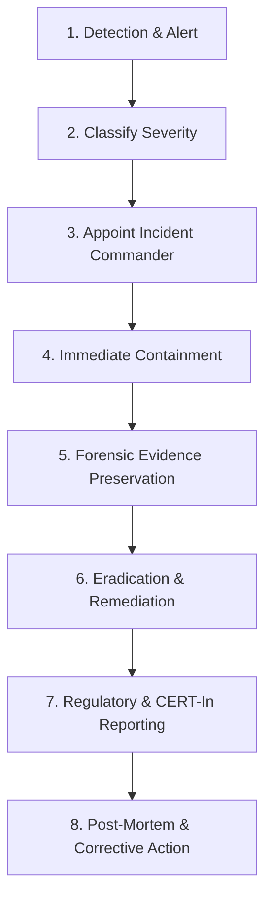

# Incident Response & Breach Management Runbook
## Unified Healthcare Management Ecosystem (SvasthNexis)
**Document Status:** Approved Operational Standard  
**Regulatory Context:** Information Technology Act, 2000 Section 70B; CERT-In Cybersecurity Directions (28 April 2022); Digital Personal Data Protection Act, 2023.  
**Critical Target:** Incident containment within 1 hour; mandatory CERT-In reporting within 6 hours of noticing specified cybersecurity incidents.

---

### 1. Incident Classification Matrix

| Severity Level | Definition | Examples | Incident Lead | Notification SLA |
|---|---|---|---|---|
| **SEV-1 (Critical)** | Active data breach of medical records, unauthorized admin takeover, ransomware, core API outage affecting all facilities. | Leaked patient vault documents, rogue admin elevation, ransomware on database. | Chief Information Security Officer (CISO) / Incident Commander | Immediate internal; CERT-In within 6 hours. |
| **SEV-2 (High)** | Single-tenant isolation failure, payment webhook forgery, DDoS attack degrading booking, unvalidated lab result release. | Hospital A seeing Hospital B records, forged payment callback attempt. | Lead Security Engineer | Internal within 30 min; CERT-In if breach suspected. |
| **SEV-3 (Medium)** | Isolated component degradation, third-party video adapter failure, rate limit triggers. | SMS gateway failure, Redis temporary failover. | Platform On-Call Engineer | Internal within 2 hours. |
| **SEV-4 (Low)** | Minor UI bug, benign scanner ping, non-exploitable exception. | Failed login attempts within normal thresholds. | Triage Engineer | Next business day. |

---

### 2. Immediate Triage & Containment (Step-by-Step)



1. **Step 1 - Detection & Isolation:**
   - For suspected credential leaks or rogue admin actions: Invoke emergency session termination:
     ```bash
     npm run cli -- identity:revoke-all-sessions --user-id=<USER_ID>
     ```
   - For compromised IP/network ranges: Apply Cloudflare/WAF block rules immediately.
   - For affected tenant data leak: Temporarily place tenant in maintenance mode to halt read traffic.
2. **Step 2 - Preserve Forensic Evidence:**
   - Do NOT reboot or delete compromised instances.
   - Capture memory snapshots and database transaction logs (`pg_wal`).
   - Export immutable `audit_events` and API access logs with cryptographic SHA-256 hashes.
3. **Step 3 - CERT-In 6-Hour Reporting Protocol:**
   - Compile mandatory incident reporting details per CERT-In Incident Reporting Form:
     - Name of organisation: SvasthNexis Healthcare Operations
     - Time of confirmation: ISO 8601 UTC timestamp
     - Affected system description: Host, IP, domain, database
     - Type of incident: Unauthorized access / Data breach / Ransomware
     - Initial impact assessment: Estimated number of records/users affected
     - Mitigation actions taken: Credentials rotated, firewall updated, session revoked
   - Dispatch encrypted email to `incident@cert-in.org.in` or submit via CERT-In incident reporting portal within 6 hours.
4. **Step 4 - Remediate & Restore:**
   - Rotate database credentials, JWT secrets, and storage encryption keys.
   - Verify integrity of backups before restoration.
   - Perform patch validation in staging before pushing hotfix to production.

---

### 3. Contact & Escalation Roster
- **Incident Commander:** CISO / Platform Engineering Lead
- **Clinical Risk Lead:** Chief Medical Officer (for any incident involving patient safety)
- **Legal & Data Protection Officer:** General Counsel
- **Emergency Hotline:** Internal PagerDuty Security Escalation Policy
